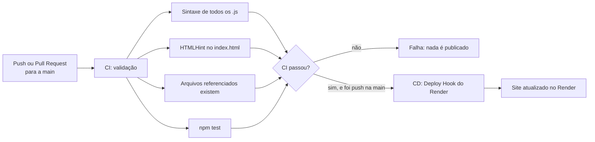

<div align="center">


# Fornai

**Battle royale em primeira pessoa que roda direto no navegador.**
Sobreviva, fique dentro da zona segura e seja o último de pé.

[](https://github.com/joohnyxxz/Fornai/actions/workflows/ci-cd.yml)


[**▶ Jogar agora**](https://fornai-722o.onrender.com) · [Como jogar](#-como-jogar) · [Rodar localmente](#-rodar-localmente) · [Pipeline CI/CD](#-pipeline-cicd)

</div>

---

## Sobre o projeto

O Fornai nasceu como um projeto pessoal de 2025: um jogo de tiro estilo *battle royale* feito só com HTML, CSS e JavaScript puro, sem bibliotecas nem engine. Ele foi retomado como trabalho de **DevOps** (CI/CD com GitHub Actions e deploy automático no Render) e, com isso, ganhou uma refatoração completa: código organizado em módulos, testes automáticos, um mundo 3D com chão em perspectiva, tempestade em fases, um campo de paintball com paredes que têm física de verdade e 19 adversários controlados por inteligência artificial.

A estética é inspirada nos primeiros capítulos dos battle royales mais famosos: dia ensolarado, cores vivas, formas "gordinhas" e tempestade roxa. É um projeto de fã e **não tem afiliação** com nenhuma empresa. Nenhum logo, imagem, personagem ou fonte oficial é usado.

## Estado atual

O projeto está sendo entregue em partes, cada uma em seu próprio Pull Request:

| Parte | Conteúdo | Status |
|---|---|---|
| **1** | Estrutura em módulos, mundo diurno, campo de paintball com física, zona segura em fases com tempestade visível, testes e CI | ✅ Concluída |
| **2** | 19 bots com IA, tiro com bolinhas de tinta, vitória e derrota, personagens de paintball | ✅ Esta versão |
| **3** | HUD completo (vida e escudo), itens e efeitos de impacto | 🔜 Planejada |
| **4** | Ajustes finais, desempenho e acabamento | 🔜 Planejada |

## Como jogar

| Tecla | Ação |
|---|---|
| `W` / `↑` | Andar para frente |
| `S` / `↓` | Andar para trás |
| `A` / `D` | Andar para a esquerda / para a direita (sem girar a câmera) |
| **Mouse** | Ao iniciar, o cursor fica **preso** na tela: qualquer movimento gira a câmera, na **horizontal e na vertical** |
| **Botão esquerdo do mouse** (segurar) | Atirar bolinhas de tinta |
| `Esc` | Solta o cursor e **pausa** o jogo; clique para continuar |
| `←` / `→` | Também giram a câmera na horizontal (alternativa ao mouse) |
| `Shift` | Correr |

**Objetivo:** ser o **último de pé** entre 20 jogadores (você e 19 bots). Cada acerto de tinta tira 20 de vida (5 acertos eliminam), e as paredes bloqueiam os tiros, então use os bunkers como cobertura. Fique dentro da **zona segura**: a tempestade roxa fecha em 5 fases e machuca quem está fora dela. Uma partida dura de 3 a 4 minutos.

**HUD:**
- **Vida:** barra no canto superior esquerdo, com o placar **VIVOS** e **ELIM.** (suas eliminações) logo abaixo.
- **Mira e arma:** a mira fica no centro da tela, e o **marcador de paintball** aparece no canto direito, com recuo e clarão a cada tiro, balanço ao andar e atraso ao girar a câmera. Um **X vermelho** aparece quando você acerta alguém, e as bordas ficam vermelhas quando você leva tinta.
- **Contagem:** 3, 2, 1, JÁ! antes de começar; dá para olhar em volta, mas não andar nem atirar.
- **Zona:** tempo até a tempestade fechar (ou fechando), fase atual e uma **seta** apontando para o centro da próxima zona segura.
- **Minimapa** (canto inferior esquerdo, para não cobrir a arma): zona atual (círculo branco), próxima zona (tracejada), a tempestade em roxo e cada bunker na sua cor. A seta amarela é você.

## Rodar localmente

O jogo usa **módulos ES**, então precisa ser servido por um servidor HTTP (abrir o `index.html` com duplo clique não funciona). Qualquer servidor estático serve:

```bash
# opção 1: Python
python -m http.server 8000

# opção 2: Node (sem instalar nada no projeto)
npx serve .
```

Depois abra `http://localhost:8000`.

### Parâmetros de teste (na URL)

Úteis para validar a zona segura sem esperar nem morrer:

| Parâmetro | Efeito | Exemplo |
|---|---|---|
| `ts=N` | Acelera o tempo da zona N vezes | `?ts=8` |
| `imortal` | O jogador não leva dano (nem de tinta, nem da tempestade) | `?imortal` |
| `debug` | Expõe o estado do jogo em `window.__fornai` | `?debug` |

Combine à vontade: `http://localhost:8000/?ts=8&imortal`.

## Testes

Os testes usam o executor nativo do Node (`node:test`), sem nenhuma dependência. Requer Node 20 ou superior.

```bash
npm test
```

O que é coberto (lógica pura, sem navegador):

- **Zona segura:** o raio nunca cresce, chega ao tamanho de cada fase, cada novo círculo fica **totalmente dentro** do anterior (testado com 25 sementes), o dano por segundo aumenta a cada fase e passos de tempo grandes não travam.
- **Controles:** `A`/`D` andam de lado sem girar a câmera, o mouse gira a câmera na horizontal e na vertical (com limite para cima e para baixo, e sem alterar o movimento), a diagonal não é mais rápida que andar reto, o jogador desliza ao longo das paredes e não as atravessa nem em alta velocidade nem sai do mapa.
- **Física:** colisão com deslizamento contra paredes e tambores, movimento em passos curtos (sem "tunelamento"), raios com distância, normal e posição na superfície corretas, o objeto mais próximo vence quando há vários na frente e linha de visão (inclusive simétrica).
- **Combate:** a bolinha voa em linha reta, acerta o jogador mais perto, nunca acerta quem atirou, para na parede (que **protege** quem está atrás), não atravessa a parede nem num quadro longo e cai depois do tempo de vida.
- **Tiro 3D:** a inclinação sobe e desce a bolinha na proporção certa, tiro para o alto passa por cima do jogador e de paredes baixas, tiro para baixo bate no chão (e ainda acerta quem está perto), o respingo guarda a altura do impacto e uma bolinha que sobe para sempre só expira.
- **Boca do marcador:** a tinta sai à frente, à direita e abaixo da câmera, **cruza a mira** na distância de convergência, acompanha a câmera (para cima, para baixo e para os lados) e mirar para o alto erra o alvo enquanto mirar reto acerta.
- **Bots:** miram em 3D, nunca saem do mapa, só atiram com linha de visão livre, demoram para reagir, miram com pequeno erro, fogem da tempestade, patrulham e procuram cobertura sem linha de visão para o inimigo.
- **Partida:** 19 bots, nascimentos livres e afastados, contagem, 5 acertos eliminam, vitória e derrota (por tiro e pela tempestade), tudo congela no fim e duas **simulações longas** garantem que ninguém atravesse paredes ou saia do mapa e que os bots se eliminem entre si.
- **Mundo:** geração determinística por semente, objetos dentro do mapa e sem sobreposição, paredes que formam contornos fechados com as medidas certas e normais apontando para fora, cores e texturas válidas, todo objeto mais alto que a câmera (cobertura de verdade) e ponto de nascimento livre.

## Estrutura do repositório

```text
.
├── index.html              # página única do jogo
├── style.css               # estilos (menu, HUD, modais)
├── logofornai.png
├── assets/
│   └── ground/grass.jpg    # textura de grama do chão (1024 px, repetida)
├── src/
│   ├── main.js             # laço do jogo e estados (menu, partida, fim)
│   ├── config.js           # todos os números do jogo (balanceamento)
│   ├── zone.js             # zona segura em fases (lógica pura)
│   ├── match.js            # a partida: spawns, tiros, dano, tempestade, vitória e derrota
│   ├── bot.js              # inteligência artificial dos adversários
│   ├── combat.js           # bolinhas de tinta (voo, acerto em jogador e em parede)
│   ├── physics.js          # colisão, raios (tiros) e linha de visão (lógica pura)
│   ├── world.js            # campo de paintball: geração dos bunkers, painéis e tambores
│   ├── player.js           # movimento do jogador
│   ├── sprites.js          # personagens de paintball e a arma do jogador, desenhados por código
│   ├── render.js           # céu, chão, paredes do campo, tempestade, jogadores e tinta
│   ├── util.js             # funções matemáticas pequenas
│   ├── minimap.js          # minimapa
│   ├── hud.js              # vida, zona e seta
│   ├── input.js            # teclado e mouse
│   └── rng.js              # números aleatórios com semente
├── tests/                  # testes automáticos
├── .github/workflows/
│   └── ci-cd.yml           # pipeline CI/CD
└── package.json
```

## Como funciona

### Renderização

Não há engine nem WebGL: tudo é desenhado em um `<canvas>` 2D com uma projeção em perspectiva "estilo Doom".

- **Céu:** gradiente com nuvens que se movem conforme você gira a câmera.
- **Chão:** calculado pixel a pixel. Para cada linha da tela abaixo do horizonte, calcula-se a distância no mundo e, para cada coluna, a posição exata no chão. A cor vem de uma **textura real de grama**, amostrada com interpolação bilinear e **mipmaps** (versões menores usadas ao longe, para não serrilhar), com variação de tom em larga escala para esconder a repetição e neblina de distância. Fora do mapa há mar e uma faixa de areia.
- **Tempestade:** uma parede roxa translúcida na borda do círculo, calculada com a interseção raio-círculo para cada coluna da tela. O chão fora da zona é tingido de roxo e a borda brilha.
- **Paredes do campo (raycasting):** os bunkers, painéis e tambores são **geometria de verdade**, não imagens. Para cada coluna da tela, um raio sai do jogador e encontra a primeira parede ou cilindro; a altura da coluna vem da distância (perspectiva correta) e a textura vem da posição exata onde o raio bateu. Por isso a parede fica parada no mapa e mostra o lado certo de qualquer ângulo, sem nenhuma imagem que "acompanhe" a câmera. As faces recebem luz de acordo com a direção em que olham, as quinas ganham um contorno escuro e tudo se dissolve na neblina de distância, igual ao chão.
- **Texturas de inflável:** geradas por código ao carregar o jogo, sem nenhuma imagem: gomos inflados com luz no meio e sombra nas costuras, faixa de destaque, sombra de contato na base e **respingos de tinta** (que repetem sem emenda). São 7 cores com 3 variações cada.
- **Tempestade e paredes:** a parede roxa da tempestade só aparece acima do topo das paredes do campo que estão na sua frente.

### Zona segura

A zona é uma máquina de estados (`esperando → encolhendo → esperando → … → final`) baseada em tempo, implementada em `src/zone.js` e totalmente testada. O próximo círculo é sorteado sempre **dentro** do anterior.

| Fase | Espera | Encolhe | Raio final | Dano/s fora da zona |
|---|---|---|---|---|
| 1 | 45 s | 30 s | 1500 | 1 |
| 2 | 30 s | 25 s | 900 | 2 |
| 3 | 25 s | 20 s | 500 | 5 |
| 4 | 20 s | 15 s | 220 | 8 |
| 5 | 15 s | 15 s | 50 | 10 |

Todos esses números ficam em `src/config.js` e podem ser ajustados sem tocar na lógica.

### Mundo e física

O mapa tem 3000 × 3000 unidades e vira um **campo de paintball** gerado por semente (o mesmo número gera sempre o mesmo campo): 12 bunkers em forma de caixa, 10 painéis compridos e 14 tambores, todos mais altos que a câmera (cobertura de verdade), bem espaçados e em cores vivas. O minimapa mostra cada um na sua cor.

A física mora em `src/physics.js` (lógica pura, 100% testada) e usa dois tipos de colisor: **paredes retas** (caixas e painéis, 4 paredes cada, giradas por um ângulo qualquer) e **cilindros** (tambores).

- **Colisão com deslizamento:** o jogador é um círculo. Ao encostar numa parede só a parte do movimento que entra nela é cancelada, então ele desliza ao longo dela em vez de ficar preso.
- **Sem atravessar:** o movimento é dividido em passos curtos, então nem correndo, nem num quadro lento, dá para "pular" uma parede fina.
- **Raios:** `raycast` devolve distância, objeto, normal da superfície e posição ao longo dela. O mesmo cálculo desenha as paredes na tela e vai bloquear os **tiros** na parte 2.
- **Linha de visão:** `lineOfSight` diz se dois pontos se enxergam. Vai servir para os bots só atirarem (e só se esconderem) de verdade.

### Câmera e mouse

O mouse usa a **Pointer Lock API** do navegador: ao clicar em *Iniciar Jogo* o cursor fica preso e some, e cada movimento vira rotação (horizontal) e inclinação (vertical). `Esc` solta o cursor e **pausa** a partida (aparece "Pausado"); clicar de novo prende o mouse e continua. Se o navegador não permitir prender o mouse, o jogo segue normalmente e dá para girar a câmera segurando o botão direito e arrastando.

Olhar para cima e para baixo move o **horizonte** (a técnica clássica de *y-shearing*, usada em jogos como o Doom): o céu, o chão, as paredes e os jogadores se deslocam juntos. O combate também é em **3D**: a tinta segue a inclinação da câmera (veja abaixo).

### Combate

- **Bolinhas de tinta em 3D:** cada bolinha tem posição no campo **e altura**, e voa em linha reta a 900 unidades por segundo, subindo ou descendo conforme a inclinação do tiro. Em cada quadro, o trecho percorrido é testado contra o chão, as paredes e os jogadores, e **vale o que estiver mais perto**.
  - **Altura do corpo:** só acerta um jogador se a bolinha estiver entre o chão e a altura dele (tiro para o alto passa por cima da cabeça, e tiro muito baixo bate no chão antes).
  - **Paredes:** a bolinha bate se estiver abaixo do topo da parede; mais alta, **passa por cima** (e ainda pode bater numa parede alta mais atrás).
  - **Respingos:** ao bater numa parede deixa um respingo da cor de quem atirou **na altura exata** do impacto, e no chão deixa uma mancha achatada pela perspectiva (até 90 ficam no campo).
- **O tiro segue a câmera:** a bolinha sai da **boca do marcador** (um pouco à frente, à direita e abaixo do olho, sempre fixa em relação à câmera, inclusive ao olhar para cima e para baixo) e é apontada para o ponto que a mira enxerga a 520 unidades. Por isso a tinta nasce na ponta da arma desenhada na tela e cruza o centro da mira.
- **Dano:** 100 de vida, 20 por acerto. A tempestade tira vida por segundo, sem o efeito de "levou tinta".
- **Marcador do jogador:** segure o botão esquerdo para atirar a cada 0,2 s, com uma pequena imprecisão horizontal e vertical. Se você estiver encostado numa parede, o tiro sai do próprio corpo (a boca ficaria do outro lado dela).

### Inteligência dos bots

Cada bot é uma máquina de estados (`src/bot.js`) com sentidos limitados, e todos os números ficam em `src/config.js`:

| Estado | O que faz |
|---|---|
| **Patrulha** | Anda entre pontos sorteados dentro da zona segura. |
| **Investigar** | Vai até onde viu ou levou tiro por último. |
| **Combate** | Tem um alvo à vista: mantém a distância preferida, anda de lado e atira. |
| **Cobertura** | Ferido ou sob fogo, procura um ponto onde o inimigo **não tem linha de visão**, espera escondido e depois "espia". |
| **Tempestade** | Fora da zona (ou em área que vai fechar): corre para a zona segura, que tem prioridade sobre tudo. |

- **Percepção justa:** o bot só enxerga quem está ao alcance **e sem parede no meio**; não atravessa a visão pelas paredes.
- **Mira em 3D:** o bot mira do marcador até o peito do alvo (horizontal e vertical), com erro nas duas direções.
- **Erros humanos:** demora para reagir ao ver alguém, a mira treme mais com a distância e quando ele está em movimento, e cada bot tem uma **habilidade** própria (entre 0,75 e 1,25).
- **Movimento:** o bot sonda à frente e desvia das paredes, desliza ao encostar, e se ficar preso numa quina troca de rota.
- **Calibragem:** o ritmo foi medido por simulação sem navegador (restam ~15 jogadores em 35 s, 5 em 2 min e 2 em 3 min). Todos os bots lutam contra todos, não só contra você.

### Arma do jogador

O marcador que aparece no canto direito da tela também é **desenhado por código** (`buildWeaponSprite`): cano com boca, corpo com faixa amarela, depósito translúcido com bolinhas coloridas, luva e manga. Ele fica ancorado onde a bolinha nasce, então tinta e arma sempre combinam. Ao atirar, recua ao longo do cano e solta um clarão; ao andar, balança; ao girar a câmera, atrasa um pouco e volta, como em qualquer FPS.

### Personagens

Os jogadores são **desenhados por código** (`src/sprites.js`), sem nenhuma imagem externa: capacete com máscara e óculos, colete com a cor do time, joelheiras e marcador com depósito de bolinhas. Cada cor tem 6 poses (parado, andando, atirando com clarão, levando tinta, eliminado de mãos para cima) em duas vistas (frente e costas, conforme o lado que a câmera enxerga). Ao levar tinta o personagem pisca em vermelho, e os que estão atrás de uma parede são recortados por coluna.

## Pipeline CI/CD

Todo o fluxo é automatizado com **GitHub Actions** (`.github/workflows/ci-cd.yml`) e publica no **Render**.



- **CI** roda em todo push na `main` e em todo Pull Request para a `main`.
- **CD** só roda em *push* na `main` e **somente se a CI passar** (`needs: ci`). Em Pull Requests, o deploy é pulado.
- O deploy é acionado pela própria pipeline, chamando um **Deploy Hook** do Render. A URL do hook fica guardada em **GitHub Secrets** (`RENDER_DEPLOY_HOOK_URL`), nunca no código.
- O **Auto-Deploy nativo do Render fica desligado**, para não haver deploy duplicado.
- O Render usa **Static Site**: o jogo é 100% estático, então não precisa de servidor, banco de dados nem Docker.

### Configurar no seu próprio fork

1. No Render, crie um **Static Site** apontando para o repositório (branch `main`, *Publish Directory* `.`, sem *Build Command*).
2. Em **Settings → Build & Deploy**, desligue o **Auto-Deploy**.
3. Em **Settings → Deploy Hook**, copie a URL.
4. No GitHub, em **Settings → Secrets and variables → Actions**, crie o secret `RENDER_DEPLOY_HOOK_URL` com essa URL.

## Créditos e licenças

- **Código:** licença [MIT](LICENSE).
- **Textura do chão:** [`grass_ground`](https://polyhaven.com/a/grass_ground), do [Poly Haven](https://polyhaven.com), licença **CC0**. Recebeu correção de cor (de grama seca para verde vivo) e fica em `assets/ground/grass.jpg`.
- **Fontes:** [Barlow Condensed](https://fonts.google.com/specimen/Barlow+Condensed) e [Lilita One](https://fonts.google.com/specimen/Lilita+One), via Google Fonts (licença SIL Open Font).

## Sobre o processo

Este repositório foi trabalhado como um **laboratório de DevOps com IA generativa**: a pipeline, a refatoração, a física, os bots, os testes e o campo de paintball foram construídos em conversa com um assistente de IA (Claude), com cada etapa revisada, testada e aprovada manualmente antes de ir para a `main`.
