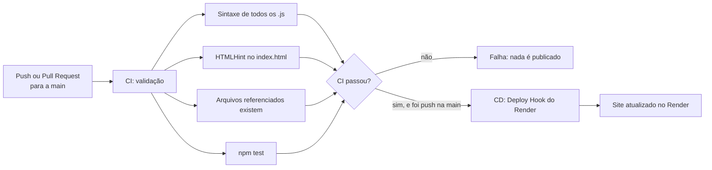

<div align="center">


# Fornai

**Battle royale em primeira pessoa que roda direto no navegador.**
Sobreviva, fique dentro da zona segura e seja o último de pé.

[](https://github.com/joohnyxxz/Fornai/actions/workflows/ci-cd.yml)


[**▶ Jogar agora**](https://fornai-722o.onrender.com) · [Como jogar](#-como-jogar) · [Rodar localmente](#-rodar-localmente) · [Pipeline CI/CD](#-pipeline-cicd)

</div>

---

## Sobre o projeto

O Fornai nasceu como um projeto pessoal de 2025: um jogo de tiro estilo *battle royale* feito só com HTML, CSS e JavaScript puro, sem bibliotecas nem engine. Ele foi retomado como trabalho de **DevOps** (CI/CD com GitHub Actions e deploy automático no Render) e, com isso, ganhou uma refatoração completa: código organizado em módulos, testes automáticos, um mundo 3D com chão em perspectiva, tempestade em fases e um campo de paintball com paredes que têm física de verdade.

A estética é inspirada nos primeiros capítulos dos battle royales mais famosos: dia ensolarado, cores vivas, formas "gordinhas" e tempestade roxa. É um projeto de fã e **não tem afiliação** com nenhuma empresa. Nenhum logo, imagem, personagem ou fonte oficial é usado.

## Estado atual

O projeto está sendo entregue em partes, cada uma em seu próprio Pull Request:

| Parte | Conteúdo | Status |
|---|---|---|
| **1** | Estrutura em módulos, mundo diurno, campo de paintball com física, zona segura em fases com tempestade visível, testes e CI | ✅ Esta versão |
| **2** | Bots com sprites e IA (pouso, combate, uso de cobertura, fuga da tempestade) e tiro, usando a física das paredes | 🔜 Próxima |
| **3** | HUD completo (vida e escudo), itens e efeitos de impacto | 🔜 Planejada |
| **4** | Ajustes finais, desempenho e acabamento | 🔜 Planejada |

> Nesta versão ainda **não há bots nem tiro**. O foco é validar o mundo e a zona segura.

## Como jogar

| Tecla | Ação |
|---|---|
| `W` / `↑` | Andar para frente |
| `S` / `↓` | Andar para trás |
| `A` / `D` | Andar para a esquerda / para a direita (sem girar a câmera) |
| **Botão direito do mouse** (segurar e arrastar) | Girar a câmera |
| `←` / `→` | Também giram a câmera (alternativa ao mouse) |
| `Shift` | Correr |

**Objetivo:** ficar dentro da **zona segura**. A tempestade roxa fecha em 5 fases e machuca quem está fora dela.

**HUD:**
- **Vida:** barra no canto superior esquerdo.
- **Zona:** tempo até a tempestade fechar (ou fechando), fase atual e uma **seta** apontando para o centro da próxima zona segura.
- **Minimapa:** zona atual (círculo branco), próxima zona (tracejada) e a tempestade em roxo. A seta amarela é você.

## Rodar localmente

O jogo usa **módulos ES**, então precisa ser servido por um servidor HTTP (abrir o `index.html` com duplo clique não funciona). Qualquer servidor estático serve:

```bash
# opção 1: Python
python -m http.server 8000

# opção 2: Node (sem instalar nada no projeto)
npx serve .
```

Depois abra `http://localhost:8000`.

### Parâmetros de teste (na URL)

Úteis para validar a zona segura sem esperar nem morrer:

| Parâmetro | Efeito | Exemplo |
|---|---|---|
| `ts=N` | Acelera o tempo da zona N vezes | `?ts=8` |
| `imortal` | A tempestade não causa dano | `?imortal` |
| `debug` | Expõe o estado do jogo em `window.__fornai` | `?debug` |

Combine à vontade: `http://localhost:8000/?ts=8&imortal`.

## Testes

Os testes usam o executor nativo do Node (`node:test`), sem nenhuma dependência. Requer Node 20 ou superior.

```bash
npm test
```

O que é coberto (lógica pura, sem navegador):

- **Zona segura:** o raio nunca cresce, chega ao tamanho de cada fase, cada novo círculo fica **totalmente dentro** do anterior (testado com 25 sementes), o dano por segundo aumenta a cada fase e passos de tempo grandes não travam.
- **Controles:** `A`/`D` andam de lado sem girar a câmera, a câmera gira pelo mouse, a diagonal não é mais rápida que andar reto, o jogador desliza ao longo das paredes e não as atravessa nem em alta velocidade nem sai do mapa.
- **Física:** colisão com deslizamento contra paredes e tambores, movimento em passos curtos (sem "tunelamento"), raios com distância, normal e posição na superfície corretas, o objeto mais próximo vence quando há vários na frente e linha de visão (inclusive simétrica).
- **Mundo:** geração determinística por semente, objetos dentro do mapa e sem sobreposição, paredes que formam contornos fechados com as medidas certas e normais apontando para fora, cores e texturas válidas, todo objeto mais alto que a câmera (cobertura de verdade) e ponto de nascimento livre.

## Estrutura do repositório

```text
.
├── index.html              # página única do jogo
├── style.css               # estilos (menu, HUD, modais)
├── logofornai.png
├── assets/
│   └── ground/grass.jpg    # textura de grama do chão (1024 px, repetida)
├── src/
│   ├── main.js             # laço do jogo e estados (menu, partida, fim)
│   ├── config.js           # todos os números do jogo (balanceamento)
│   ├── zone.js             # zona segura em fases (lógica pura)
│   ├── physics.js          # colisão, raios (tiros) e linha de visão (lógica pura)
│   ├── world.js            # campo de paintball: geração dos bunkers, painéis e tambores
│   ├── player.js           # movimento do jogador
│   ├── render.js           # céu, chão em perspectiva, paredes do campo e tempestade
│   ├── minimap.js          # minimapa
│   ├── hud.js              # vida, zona e seta
│   ├── input.js            # teclado
│   └── rng.js              # números aleatórios com semente
├── tests/                  # testes automáticos
├── .github/workflows/
│   └── ci-cd.yml           # pipeline CI/CD
└── package.json
```

## Como funciona

### Renderização

Não há engine nem WebGL: tudo é desenhado em um `<canvas>` 2D com uma projeção em perspectiva "estilo Doom".

- **Céu:** gradiente com nuvens que se movem conforme você gira a câmera.
- **Chão:** calculado pixel a pixel. Para cada linha da tela abaixo do horizonte, calcula-se a distância no mundo e, para cada coluna, a posição exata no chão. A cor vem de uma **textura real de grama**, amostrada com interpolação bilinear e **mipmaps** (versões menores usadas ao longe, para não serrilhar), com variação de tom em larga escala para esconder a repetição e neblina de distância. Fora do mapa há mar e uma faixa de areia.
- **Tempestade:** uma parede roxa translúcida na borda do círculo, calculada com a interseção raio-círculo para cada coluna da tela. O chão fora da zona é tingido de roxo e a borda brilha.
- **Paredes do campo (raycasting):** os bunkers, painéis e tambores são **geometria de verdade**, não imagens. Para cada coluna da tela, um raio sai do jogador e encontra a primeira parede ou cilindro; a altura da coluna vem da distância (perspectiva correta) e a textura vem da posição exata onde o raio bateu. Por isso a parede fica parada no mapa e mostra o lado certo de qualquer ângulo, sem nenhuma imagem que "acompanhe" a câmera. As faces recebem luz de acordo com a direção em que olham, as quinas ganham um contorno escuro e tudo se dissolve na neblina de distância, igual ao chão.
- **Texturas de inflável:** geradas por código ao carregar o jogo, sem nenhuma imagem: gomos inflados com luz no meio e sombra nas costuras, faixa de destaque, sombra de contato na base e **respingos de tinta** (que repetem sem emenda). São 7 cores com 3 variações cada.
- **Tempestade e paredes:** a parede roxa da tempestade só aparece acima do topo das paredes do campo que estão na sua frente.

### Zona segura

A zona é uma máquina de estados (`esperando → encolhendo → esperando → … → final`) baseada em tempo, implementada em `src/zone.js` e totalmente testada. O próximo círculo é sorteado sempre **dentro** do anterior.

| Fase | Espera | Encolhe | Raio final | Dano/s fora da zona |
|---|---|---|---|---|
| 1 | 45 s | 30 s | 1500 | 1 |
| 2 | 30 s | 25 s | 900 | 2 |
| 3 | 25 s | 20 s | 500 | 5 |
| 4 | 20 s | 15 s | 220 | 8 |
| 5 | 15 s | 15 s | 50 | 10 |

Todos esses números ficam em `src/config.js` e podem ser ajustados sem tocar na lógica.

### Mundo e física

O mapa tem 3000 × 3000 unidades e vira um **campo de paintball** gerado por semente (o mesmo número gera sempre o mesmo campo): 12 bunkers em forma de caixa, 10 painéis compridos e 14 tambores, todos mais altos que a câmera (cobertura de verdade), bem espaçados e em cores vivas. O minimapa mostra cada um na sua cor.

A física mora em `src/physics.js` (lógica pura, 100% testada) e usa dois tipos de colisor: **paredes retas** (caixas e painéis, 4 paredes cada, giradas por um ângulo qualquer) e **cilindros** (tambores).

- **Colisão com deslizamento:** o jogador é um círculo. Ao encostar numa parede só a parte do movimento que entra nela é cancelada, então ele desliza ao longo dela em vez de ficar preso.
- **Sem atravessar:** o movimento é dividido em passos curtos, então nem correndo, nem num quadro lento, dá para "pular" uma parede fina.
- **Raios:** `raycast` devolve distância, objeto, normal da superfície e posição ao longo dela. O mesmo cálculo desenha as paredes na tela e vai bloquear os **tiros** na parte 2.
- **Linha de visão:** `lineOfSight` diz se dois pontos se enxergam. Vai servir para os bots só atirarem (e só se esconderem) de verdade.

## Pipeline CI/CD

Todo o fluxo é automatizado com **GitHub Actions** (`.github/workflows/ci-cd.yml`) e publica no **Render**.



- **CI** roda em todo push na `main` e em todo Pull Request para a `main`.
- **CD** só roda em *push* na `main` e **somente se a CI passar** (`needs: ci`). Em Pull Requests, o deploy é pulado.
- O deploy é acionado pela própria pipeline, chamando um **Deploy Hook** do Render. A URL do hook fica guardada em **GitHub Secrets** (`RENDER_DEPLOY_HOOK_URL`), nunca no código.
- O **Auto-Deploy nativo do Render fica desligado**, para não haver deploy duplicado.
- O Render usa **Static Site**: o jogo é 100% estático, então não precisa de servidor, banco de dados nem Docker.

### Configurar no seu próprio fork

1. No Render, crie um **Static Site** apontando para o repositório (branch `main`, *Publish Directory* `.`, sem *Build Command*).
2. Em **Settings → Build & Deploy**, desligue o **Auto-Deploy**.
3. Em **Settings → Deploy Hook**, copie a URL.
4. No GitHub, em **Settings → Secrets and variables → Actions**, crie o secret `RENDER_DEPLOY_HOOK_URL` com essa URL.

## Créditos e licenças

- **Código:** licença [MIT](LICENSE).
- **Textura do chão:** [`grass_ground`](https://polyhaven.com/a/grass_ground), do [Poly Haven](https://polyhaven.com), licença **CC0**. Recebeu correção de cor (de grama seca para verde vivo) e fica em `assets/ground/grass.jpg`.
- **Fontes:** [Barlow Condensed](https://fonts.google.com/specimen/Barlow+Condensed) e [Lilita One](https://fonts.google.com/specimen/Lilita+One), via Google Fonts (licença SIL Open Font).

## Sobre o processo

Este repositório foi trabalhado como um **laboratório de DevOps com IA generativa**: a pipeline, a refatoração, a física, os testes e o campo de paintball foram construídos em conversa com um assistente de IA (Claude), com cada etapa revisada, testada e aprovada manualmente antes de ir para a `main`.
